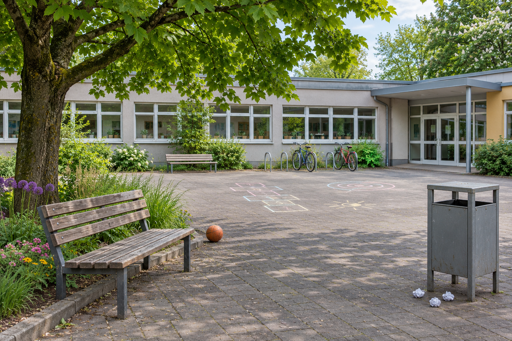

# MED-3 · Ein Bild, zwei Geschichten

**90 Minuten · Dein Ergebnis:** Original, zwei selbst bearbeitete Varianten, eine überarbeitete Variante und eine kurze Bildnotiz.

Die Schulredaktion plant einen Beitrag über Aufenthaltsorte. Wie könntest du denselben Ort im Bild unterschiedlich wirken lassen, ohne neue Gegenstände hinzuzufügen?

## 1 · Was zeigt das ganze Bild? · 15 Minuten

Beschreibe zuerst zwei sichtbare Details. Trenne davon deinen Eindruck.

**Ausgangsbild: „Ein Hof mit verschiedenen Ecken“ · IuM-Lernwerk, 2026 · KI-generiert mit OpenAI · CC BY-SA 4.0.** Konstruierte Szene ohne Personen; kein Beleg für einen realen Schulhof.

 [Bild in Originalgröße öffnen](../inhalt/material/hof-arbeitsbild.png) · [Arbeitsbild herunterladen](../inhalt/material/hof-arbeitsbild.png).

Ein **Ausschnitt** lässt Teile des Bildes weg. Eine **Farbveränderung**, etwa verringerte Sättigung, ändert die Darstellung der sichtbaren Farben. Beide können den Eindruck verändern. „Wirkt auf mich düster“ ist eine begründbare Deutung, kein sicherer Befund über die Stimmung aller Menschen dort.

Die Lehrperson zeigt am Original einmal einen engeren Ausschnitt und macht ihn rückgängig. Erkläre: Welche Information fehlt jetzt? Was hat sich am gezeigten Ort dadurch nicht verändert?

## 2 · Zwei Werkzeuge ausprobieren · 15 Minuten

Speichere das Arbeitsbild als unverändertes `hof-original.png` am vereinbarten Ort. Bewahre dort auch deine Arbeitsdateien auf. Öffne das Original im vereinbarten Editor. Nutze [[MED-3 - Bedienkarte Bildbearbeitung]]. Erstelle eine Übungskopie: einmal zuschneiden, einmal Farben deutlich entsättigen, jeweils den Unterschied zum Original betrachten. Verwechsle Vergrößern der Ansicht nicht mit Zuschneiden der Datei.

Speichere die veränderte Übungskopie als `bild-uebung.png`, öffne sie wieder und zeige den Unterschied. Öffne erst danach wieder das unveränderte Original für die nächste Bearbeitung. Wenn Öffnen oder Speichern scheitert, melde das jetzt. Du brauchst für deine späteren Varianten immer das unveränderte Original als Ausgangspunkt.

## 3 · Gestalte für eine Absicht · 45 Minuten

Ergänze während der folgenden Schritte eine einzige [[Medienbogen - Werkstattnotizen#MED-3 · Bildnotiz|Bildnotiz]]: zuerst den Plan, dann Rückmeldung und Revision.

**Für A und B zusammen:** Verwende insgesamt **mindestens einen Ausschnitt und eine Farbveränderung**. Du darfst beide Mittel kombinieren; halte sie in deiner Bildnotiz auseinander. Füge keine Gegenstände hinzu.

**Planen, 5 Minuten:** Wähle selbst zwei unterschiedliche Wirkungsabsichten für die Leserinnen und Leser des Schulblogs. Sie müssen sich an Bildmerkmalen prüfen lassen. Notiere beide **vor** dem Bearbeiten. Skizziere oder beschreibe den jeweils geplanten Ausschnitt und die Farbwirkung.

Hilfe: Ich weiß nicht, was ich verändern soll.

Du könntest etwa „Hier möchte man sitzen“ und „Hier sollte aufgeräumt werden“ prüfen. Wähle selbst zwei Bildbereiche. Welche Details stützen jeweils deine Absicht? Was würde dein Ausschnitt ausblenden? Probiere danach die Sättigung aus und vergleiche. Die Wirkung muss sich am Bild erklären lassen; eine passende Überschrift allein reicht nicht.

**Variante A, 10 Minuten:** Bearbeite eine Kopie. Speichere als `bild-A.png`. Wenn hier die erste 45-Minuten-Stunde endet, sichere auch deine Notiz. Dein Zwischenstand ist A plus Plan für B.

**Variante B, 15 Minuten:** Öffne bei einem neuen Termin zuerst A zur Kontrolle, dann das Original für B. Speichere B als `bild-B.png`.

**Wirkung prüfen, 10 Minuten:** Zeige einer Partnerperson A und B zunächst ohne deine Absichten. Sie nennt für jedes Bild einen Eindruck und ein sichtbares Detail. Erst dann zeigst du deinen Plan. Tauscht die Rollen. Notiere knapp, wo Absicht und Deutung zusammenpassen oder auseinandergehen. Jede Person bearbeitet ihre eigenen Dateien. Fehlt eine Partnerperson, übernimmt die Lehrperson den Blick von außen.

**Revision planen, 5 Minuten:** Wähle eine konkrete Verbesserung an einer Variante, die sich aus der Rückmeldung ergibt. Auch bei passender Wirkung kann etwa mehr Kontext die Aussage ehrlicher oder ein genauerer Ausschnitt die Absicht verständlicher machen. Notiere: „Ich ändere …, damit … .“

Hilfe: Die andere Person sieht etwas anderes.

Frage: „Welches Detail lässt dich so denken?“ Du musst ihre Deutung nicht übernehmen. Entscheide anhand deines Ziels, ob ein anderer Ausschnitt oder eine andere Farbwirkung hilft. Ein begründeter Unterschied ist kein Fehler der anderen Person.

## 4 · Überarbeiten und verantworten · 15 Minuten

**7 Minuten:** Führe die geplante Änderung selbst aus. Brauchst du nach dem Zuschneiden wieder mehr Bildfläche, öffne das unveränderte Original und stelle deinen neuen Ausschnitt sowie die gewünschten Farben erneut ein. Eine exportierte, beschnittene PNG enthält die entfernten Bildteile nicht mehr. Speichere zusätzlich als `bild-A-revision.png` oder `bild-B-revision.png`. Behalte die Vorfassung. Öffne die gespeicherte Revision erneut und halte die Vorfassung für den Vergleich bereit.

**5 Minuten für den zweiten Blick:** Wenn möglich, tauscht mit einem Nachbarpaar. Wählt den passenden Weg:

- **Neue Person, die deine Absicht noch nicht kennt:** Zeige zuerst nur die Revision. Frage: „Wie wirkt der Hof auf dich? Welche Stelle bringt dich darauf?“ Erkläre deine Absicht erst nach der Antwort.
- **Person, die deine Absicht schon kennt:** Zeige Vorfassung und Revision nebeneinander. Frage: „Was fällt dir jetzt anders auf? An welcher Stelle siehst du das?“ Auch ein ähnlicher Eindruck kann begründet sein.

Tauscht die Rollen. Ergänze dann knapp dieselbe Bildnotiz:

- Absicht A und B; je eine verwendete Veränderung mit möglicher Wirkung.
- Erste Rückmeldung und deine Änderung. Halte für den zweiten Blick fest: erster Eindruck einer neuen Person oder Vergleich mit der Vorfassung? Nenne die Deutung und die Bildstelle, auf die sie sich stützt.
- Welche Information geht in einem Ausschnitt verloren? Welche Aussage über den ganzen Hof wäre damit nicht belegt?
- Bildnachweis: „IuM-Lernwerk: Ein Hof mit verschiedenen Ecken, 2026, KI-generiert mit OpenAI, CC BY-SA 4.0. Bearbeitet: Ausschnitt/Farben … .“ Ergänze deine zutreffenden Änderungen.

**3 Minuten gemeinsam:** Neuer Fall: Ein Vereinsfoto zeigt nur jubelnde Personen am Rand. Kann die Redaktion daraus schließen, dass alle Gäste begeistert waren? Nenne den fehlenden Kontext und eine mögliche Gegenprüfung. Übertragt das auf eure eigenen Bilder.

Du zeigst Original, A, B, Revision und Bildnotiz. Eine fremde fertige Datei oder ein Screenshot der Anleitung ersetzt deine Bearbeitung nicht. Mehrere Deutungen sind möglich; entscheidend sind nachvollziehbare Entscheidungen und tatsächliche Änderungen.

Ergebnisort: [[Medienbogen - Sicherung#MED-3 · Bildwirkung begründen]].

