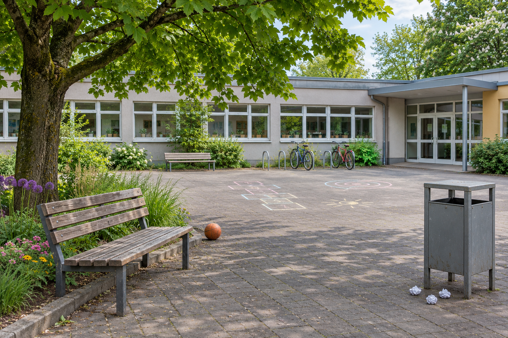

# Gesprächsimpulse für die Medienwerkstatt

Jeweils nur den betreffenden Abschnitt projizieren. Die HTML-Ausgabe bietet eine eigene große Ansicht pro Impuls. Erwartungen und Moderationshinweise stehen in [[Medienbogen - Durchführung und Auswertung]], die Ergebnissätze in [[Medienbogen - Sicherung]].

## P1 · Was lenkt den ersten Blick?

[[MED-1 - Wer lenkt unseren Blick#B · Clip auf „Loop“]]

**Was fällt dir beim ersten Ansehen auf? An welchem Moment machst du das fest?**

Nach dem Hörvergleich: Wie wirkt der Sprung in den beiden Fassungen auf dich? Welche Frage über die Flasche bleibt offen?

Für die Besprechung: Was gestaltet Mika? Was zeigt Loop zusätzlich im Feed?

## P2 · 90 Prozent – wovon?

M1: „90 Prozent gegen den Kiosk!“

M3: Frage nach Öffnung in der zweiten Pause. 18 Ja, 2 Nein. 20 freiwillig Teilnehmende bei 400 Lernenden.

M4: Eigene Beobachtung derselben Frage, keine Kontrolle der Strichzahl.

**Welche Aussage wird von welchem Beleg getragen? Welche Quelle hat einen eigenen Erkenntnisweg?**

Offene Ergebnisstruktur: Behauptung → Beleg → Reichweite → offene Frage.

## P3 · Ein Bild, zwei Geschichten

IuM-Lernwerk, KI-generiert mit OpenAI, 2026, CC BY-SA 4.0; kein realer Schulhof. [Bild vergrößern](../inhalt/material/hof-arbeitsbild.png).

**Was sehen wir tatsächlich? Was deuten wir? Was könnte ein Ausschnitt verbergen?**

## P4 · Wer darf hier was?

**Welche Erwartung steckt in Text und Bild? Was verändert die zweite Karte – und was beweist sie nicht?**

Eigene konstruierte Unterrichtskarten. Bewertet Gestaltungsentscheidungen, keine Menschen.

## P5 · Wer schreibt – und wie prüfen wir das?

„Schul-IT: In zehn Minuten wird dein Zugang gesperrt. Antworte mit deinem Passwort. Anweisung der Schulleitung. Frage niemanden.“

**Welche zwei Mittel sollen welche Handlung auslösen? Wie prüfen wir über einen bereits bekannten anderen Weg?**

Fingierte Unterrichtsnachricht. Nicht versenden, keine Daten eingeben.

